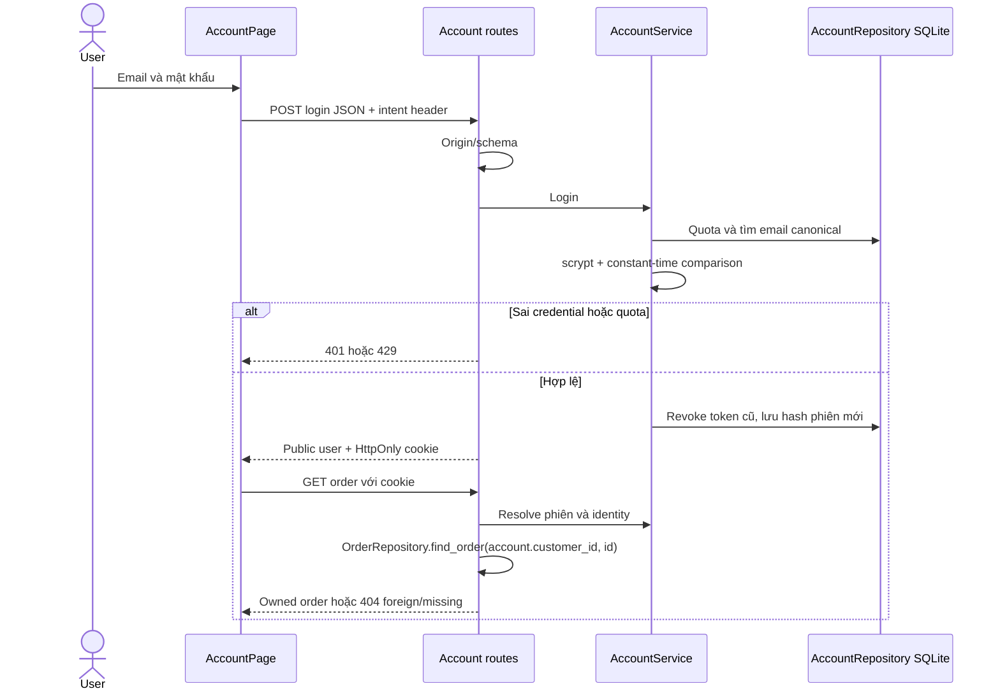

# Cortis — mở rộng ecommerce

**E2 update:** Search BM25/RRF/facets/server pagination và `/catalog` implemented, evidence/limits ở [16](16_SEARCH_BROWSE.md). Dataset visual gate có lỗi ảnh/metadata ghi trong `artifacts/backend/catalog-review-findings.json`; cần sửa nguồn ảnh và metadata trước nghiệm thu.

Yêu cầu mới ngày 15/10/2026 mở rộng demo tìm kiếm thành ecommerce thời trang đầy đủ: tài khoản, user/admin, giỏ hàng, đặt đơn và quản trị. Thay thế các câu loại trừ những chức năng này trong baseline 01–12. Giữ text/voice/image/multimodal tiếng Việt, CPU, ảnh thật có nguồn, error/recovery. Không triển khai public hoặc tự sửa Azure. Commit/push theo mốc sau kiểm tra diff/ignore/secrets.

## Research và ma trận module

Nguồn chính thức đã đọc: [H&M shopping](https://www2.hm.com/en_gb/customer-service/shopping-at-hm/online-shopping.html) (lọc/sort, size/màu, tồn kho thay đổi tới checkout); [Zalando returns](https://www.zalando.co.uk/faq/how-can-I-return-my-order.html) (đơn/trả hàng trong tài khoản); [Nike cancellation](https://www.nike.com/help/a/change-cancel-order) (hủy/thay đổi đơn theo trạng thái); [Algolia search](https://www.algolia.com/blog/engineering/natural-languages-in-search) (typo/ngôn ngữ); OWASP [password](https://cheatsheetseries.owasp.org/cheatsheets/Password_Storage_Cheat_Sheet.html), [sessions](https://cheatsheetseries.owasp.org/cheatsheets/Session_Management_Cheat_Sheet.html), [CSRF](https://cheatsheetseries.owasp.org/cheatsheets/Cross-Site_Request_Forgery_Prevention_Cheat_Sheet.html).

Đây là cơ sở thiết kế; không sao chép chính sách thương mại của các hãng. Bảng là yêu cầu cần xây, không phải bằng chứng đã chạy.

| Module | Chức năng và edge cases cần kiểm tra | Trạng thái |
| --- | --- | --- |
| Tài khoản/quyền | Register/login/logout/profile/password, user/admin; email trùng/race, giả role/customer, brute force, expiry/replay, revoke phiên khi đổi mật khẩu, CSRF | E1 implement, evidence riêng |
| Catalog/phân loại | Danh mục/breadcrumb/detail, size/màu/stock từng SKU, ảnh thật và size guide; ID lạ, hết hàng, size thiếu, ảnh hỏng, provenance/hash, direct reload | Baseline catalog có; variants/merchandising pending |
| Search | Autocomplete, synonyms, có/không dấu, typo, SKU exact, hybrid BM25/encoder thật, ảnh/multimodal/voice; rỗng/dài/Unicode/OOD/negation/đa nghĩa/giá/brand/ảnh hỏng/timeout/race | Encoder baseline có; hybrid và edge cases mở rộng pending |
| Lọc/sort/phân trang | Facets category/brand/color/size/price/availability, counts/clear/URL state, relevance/price; filters kết hợp rỗng, min>max, type sai/boundary, trang cũ, thay filter khi request đang chạy | Baseline filters có; browse facets/sorts pending |
| Wishlist | Thêm/xóa/lưu theo user/chuyển giỏ; click lặp, đổi tài khoản, SKU ngừng bán | E3 core implemented theo18; guest/variant expansion pending |
| Giỏ hàng | SKU/quantity/giá server/update/remove/tổng VND; stock đổi, số âm/boolean, SKU sai, race/session đổi | E3 core implemented theo18; variants/checkout/inventory transaction pending |
| Checkout | Địa chỉ/phí rõ/COD/trạng thái thanh toán/idempotency/transaction stock+order; double submit, race stock cuối, timeout/retry, giá đổi, rollback | Pending; provider thanh toán thật cần cấu hình riêng |
| Đơn hàng | List/detail/lookup ownership, trạng thái/hủy/trả hàng; foreign/missing cùng lỗi, hủy sau shipped, hủy lặp hoàn stock một lần, snapshot name/price | Detail baseline; auth E1; list/mutations pending |
| Admin | Dashboard/product/variants/inventory/order/users/roles/audit; user gọi admin, self-demotion/last-admin, input sai, stale update, index lệch | Gate+overview E1; CRUD/audit pending |
| Speech | Groq theo yêu cầu, local/Azure chọn explicit, sửa transcript; thiếu key/WAV sai/no-match/timeout/429/không fallback giả | Adapter/evidence lịch sử có; regression fashion thật pending |
| UI/vận hành | Tiếng Việt/responsive/accessibility/navigation/loading/empty/error/DB persistence/clean install; keyboard/axe/offline/reload/race/restart/secrets | E1 riêng; full-system pending |

## E1: accounts và ownership

SQLite `runtime/commerce/accounts.sqlite3`, không commit hoặc phục vụ browser. Accounts: UUID user_id, email ASCII canonical casefold UNIQUE, display_name NFC, password_hash scrypt salt riêng N=16384/r=8/p=5 (OWASP alternative 16 MiB), role user/admin, customer_id nullable UNIQUE do CLI map, created_at Unix UTC. Sessions chỉ lưu SHA256 token ngẫu nhiên 32 bytes và expiry 8h. Auth_attempts quota 15 phút. SQL parameterized, transaction cho duplicate/race/throttle/password change. Không tự seed admin/credential/C001.

Web registration luôn user, customer_id null; không truy cập đơn C001/C002. CLI tạo demo owner có chủ đích. Admin không mặc định được xem đơn trên endpoint customer; overview chỉ counts, chưa là module admin đầy đủ.

| Method | Endpoint | JSON body | Success |
| --- | --- | --- | --- |
| POST | `/api/v1/auth/register` | email,password,display_name | 201 user+cookie |
| POST | `/api/v1/auth/login` | email,password | 200 user+phiên mới, revoke cookie cũ |
| GET | `/api/v1/auth/me` | Không query | 200 user, 401 thiếu/hết phiên |
| POST | `/api/v1/auth/logout` | `{}` | 200 signed_out; revoke/delete cookie, idempotent |
| POST | `/api/v1/account/profile` | display_name | 200 user, không đổi role/email/owner |
| POST | `/api/v1/account/password` | current_password,password | 200 user+phiên mới, revoke tất cả phiên cũ |
| GET | `/api/v1/admin/overview` | Không query | 200 counts, 401 anonymous/403 user |

Response request_id/no-store theo 06; user chỉ user_id/email/display_name/role. Strict JSON/extra forbid. Email ≤254, name 1–80, mật khẩu mới 15–128 ký tự/≤512 UTF-8 bytes; không normalize/truncate password. Sai login: INVALID_CREDENTIALS. Trùng email: 409 ACCOUNT_EXISTS. Quota mỗi action: 10/email, 60/peer trong 900s; 429 AUTH_RATE_LIMITED/Retry-After 900. Peer request.client, không tin forwarded header.

Mutation account bắt buộc JSON + `X-Cortis-Intent: account`; Origin browser phải thuộc CORS allowlist. Cookie HttpOnly/SameSite=Lax/Path=/, Max-Age 28800; COOKIE_SECURE=true cho HTTPS, false chỉ HTTP local. Không lưu token localStorage. CORS allow credentials và intent header từ origin cấu hình. GET không mutation.

Order endpoints từ E1 **bắt buộc login**, scope từ account DB, bỏ fallback DEMO_CUSTOMER_ID (biến cũ còn để tương thích Settings). Missing/foreign cùng 404, anonymous 401. Scripts/browser checks cũ dùng C001 anonymous cần migrate fixture owner explicit; report cũ không chứng minh contract mới. Catalog/order JSON và vector/search contracts chưa đổi.

### UML/code mapping

Presentation accounts.py → Application account_service.py → Data account_repository.py; main.py DI. UI AccountPage và recovery links order. `.vpp` vẫn pending; Mermaid không thay Visual Paradigm.

## Milestones và pending

E0 research/inventory ở bảng trên, chưa full runtime audit. E1 accounts/DB/role/UI/ownership/tests/evidence/commit/push. E2 search hybrid/facets/sort/URL + frozen real quality. E3 variants/wishlist/cart + data thật. E4 checkout/order transactions/cancel/return. E5 full admin CRUD/audit. E6 full-system tests, model/browser/Groq thật riêng, clean checkout, benchmark, README/UML/acceptance. Azure evidence giữ riêng; không coi Groq là Azure verified.

Không giảm scope theo các tests đang xanh. Goal active cho tới tất cả module/gates có evidence. Xem `artifacts/backend/ACCOUNTS_REPORT.md` cho E1.
