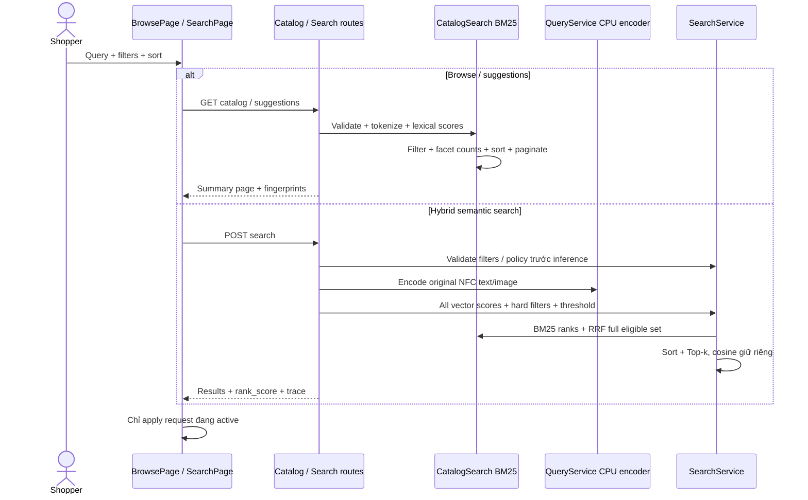

# E2 — tìm kiếm hybrid và duyệt catalog

Mở rộng theo yêu cầu ecommerce: browsing phải lọc/sort/phân trang trên server, hỗ trợ tìm SKU/từ khóa thực tế, giữ AI semantic/image/multimodal. Thay đổi có chủ đích so với baseline cosine-only; cosine và rank_score là hai giá trị riêng. Không trình bày BM25 như encoder AI.

## Research và thuật toán

Nguồn chính thức: [Elastic BM25](https://www.elastic.co/blog/practical-bm25-part-2-the-bm25-algorithm-and-its-variables), [similarity parameters](https://www.elastic.co/guide/en/elasticsearch/reference/8.19/index-modules-similarity.html), [RRF](https://www.elastic.co/docs/reference/elasticsearch/rest-apis/reciprocal-rank-fusion), [Algolia typo/language](https://www.algolia.com/blog/engineering/natural-languages-in-search).

Lexical adapter `CatalogSearch` chạy CPU trên snapshot validated: NFC query gốc giữ nguyên; đường lexical dùng NFKD/casefold, bỏ combining marks, đ→d, tách chữ/số. Encoder vẫn nhận nguyên tiếng Việt NFC có dấu. Synonyms category/color khai báo trong code versioned: áo thun/áo phông/t-shirt, balo/ba lô/backpack, sneaker, các category khác. Category token thêm 2 lần vào document; BM25 k1=1.2,b=.75 và IDF `log(1+(N-df+.5)/(df+.5))`. Stopwords loại từ giao tiếp phổ biến, không bỏ tên brand.

Typo một phép insert/delete/substitute hoặc adjacent transposition, chỉ với từ alphabet 4–24 ký tự, không đổi từ đã có trong vocabulary, chỉ chọn khi có **đúng một** candidate. Từ ngắn, chữ/số, SKU và trường hợp mơ hồ không autocorrect. Response corrections công khai input→matched; không sửa bản query gốc hoặc input của semantic encoder. Query lexical tối đa 500 ký tự normalized/64 từ, không truncate.

Hybrid: encode CPU thật → score tất cả catalog → hard filters → calibrated cosine threshold nếu relevant → semantic ranks + lexical ranks trên **toàn bộ eligible set** → RRF `sum(1/(60+rank))` → stable sort → Top-k. Không union Top-k riêng, không softmax, không coi RRF là xác suất. Exact query `P` + 3 digits (case insensitive) chỉ trả SKU ấy trong eligible set; SKU không tồn tại/hard-filter/threshold loại thì không thêm hàng khác. Image-only vẫn semantic. Text/voice/multimodal có thể chọn hybrid. Threshold vẫn qualification cosine; policy baseline chưa chứng minh precision/rejection/Hit@3 trên hybrid, cần gate riêng.

Tie-break luôn product_id tăng. Khi sort giá/tên, sort toàn bộ eligible rồi Top-k, không sort riêng các kết quả đã lấy trước. Lexical fingerprint bao gồm catalog fingerprint, version/config/synonyms/stopwords/BM25/RRF params; không thay fingerprint model/vector vì encoder và product fusion không đổi.

## API mới

`GET /api/v1/catalog`: không cần model/index/voice/login; chỉ cần catalog hợp lệ.

Query optional: `q` text; `category`, `brand`, `color` chính xác từ catalog; `min_price`, `max_price` inclusive VND integer 0–1e9; `in_stock=true|false`; `sort=relevance|price_asc|price_desc|name`; offset integer 0–1e6 default0; limit1–100 default24. Duplicate/unknown params, empty filter, invalid enum/price/type/range trả422. Unknown brand/color không được silently mở rộng query. Empty q/whitespace nghĩa browse toàn catalog; punctuation-only q không biến thành browse-all, trả no_matches.

Response request_id, products[], total, offset, limit, query {text,sort,filters}, facets {category,brand,color}, corrections[], empty_reason, catalog_fingerprint, lexical_fingerprint, retrieval `catalog|bm25|exact_sku`. Facet rows {value,count}, counts trước pagination, disjunctive: bỏ duy nhất filter của facet đó, giữ q và các filters còn lại. Zero count vẫn giữ để UI có thể recovery. Empty reason `catalog_empty|filters|no_matches|null`. Offset vượt total trả products=[] nhưng giữ total thật; UI cho về toàn catalog/trang trước. Wire product dùng summary baseline, không raw image_path/NPZ/internal JSON.

`GET /api/v1/suggestions`: q và limit1–10(default6), max500 normalized/64 từ; q<2 trả[]; prefix SKU/name ưu tiên rồi lexical score, stable ID. Response request_id/products/retrieval=lexical. Suggestions không gọi encoder/provider, không mutation/log raw query. HTTP no-store/request ID theo baseline.

Ví dụ:

```text
/api/v1/catalog?q=ao+phong&sort=price_asc&in_stock=true&limit=24
/api/v1/catalog?category=t_shirt&brand=Uniqlo&min_price=200000&max_price=600000
/api/v1/catalog?q=p001
/api/v1/suggestions?q=P00&limit=3
```

## SearchOptions và response amendment

Thêm filters.color string|null, search_strategy semantic|hybrid (default semantic để giữ các API client baseline), sort relevance|price_asc|price_desc|name (default relevance). Frontend default hybrid; image-only effective semantic. Full options response có defaults. Brand/color và missing relevant policy được kiểm tra trước encoder tại `SearchService.validate_request`.

Mỗi search result giữ score=cosine/component_scores như 05, thêm rank_score (RRF hoặc cosine khi semantic), lexical_score nullable. Meta thêm ranking_strategy semantic|rrf|exact_sku, sort, lexical_fingerprint nullable, corrections[]. Empty_reason thêm no_matches cho unknown exact SKU. UI ghi rõ ranking hybrid; nhãn Cosine không được dùng để giải thích thứ tự RRF/price/name.

## UI và navigation

Route `/catalog`: dùng snapshot page từ application API; không tải toàn bộ `/products`. Category navigation, facets/counts/clear/chips, khoảng giá submit, stock, sort, total/pagination, loading/empty/error/retry. URL là state của q/filters/sort/offset và hoạt động direct reload/Back. Request thay đổi abort request cũ, không render stale products như kết quả mới. Global CatalogProvider chỉ tải catalog đầy đủ ở trang demo semantic `/`, không tải ở browsing/account/product routes.

Autocomplete debounce250ms, abort và bỏ response cũ; dropdown không có kết quả/lỗi vẫn giữ submit khả dụng. Input combobox, ArrowUp/Down wrap, Escape đóng, Enter khi selected mở detail; Enter khi không selected submit query. Product link giữ route+query nguồn trong router state, breadcrumb quay lại đúng catalog URL; direct detail mặc định về `/catalog`.

UI giữ Cortis stone/wine/font và card system hiện có. Mobile category rail scroll ngang trong container, filter collapsible, main không overflow, header navigation hai cột đọc được. Desktop/sidebar/grid, mobile hai cột product, 360/768/1440 keyboard/axe/screenshot kiểm tra riêng.

## UML mapping



Code: application/catalog_search.py, application/search_service.py, presentation/catalog.py; main DI. Tests catalog_search/api_search, browser browse.spec.ts, real model verifier verify_search_expansion.py. Mermaid không thay `.vpp` editable baseline pending.

## Evidence và giới hạn

Report `artifacts/backend/SEARCH_BROWSE_REPORT.md`. Comparative fixtures `evaluation/search_expansion.json` được viết trước chạy; không sửa category labels theo model ranks. Smoke text category theo alias/typo giúp bắt regression nhưng chưa là frozen60 independent multimodal acceptance. Real image/multimodal upload dùng catalog photo chỉ là mechanics, không là independent image relevance. Nearest OOD vẫn có thể trả unrelated products với nhãn; relevant cần calibration fingerprint hợp lệ.

Pending: interpretation natural-language giá/brand/negation/size, nhiều lỗi gõ/mơ hồ có UX suggestions tốt hơn, synonyms review rộng hơn, frozen independent quality/OOD policies, variants/size facets, performance/cold/concurrent benchmarks toàn hệ thống. Không khẳng định xử lý mọi câu người dùng. Cart/checkout/full admin và provider live regression nằm các mốc E3–E6.
