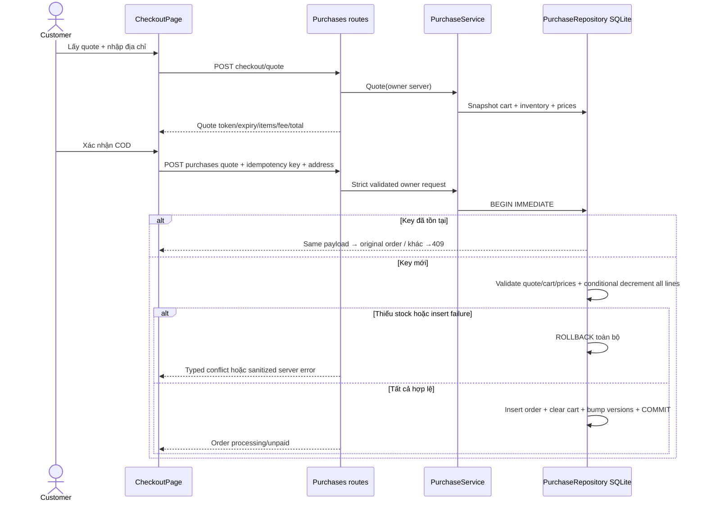

# E4 — checkout COD, inventory ledger và đơn hàng

Contract mở rộng cart/wishlist18. COD demo được ghi đơn và trừ tồn kho thực trong SQLite local; không giao hàng/thu tiền thật và không tích hợp payment provider. Các đơn lịch sử O001… vẫn là JSON scoped theo demo customer mapping. Đơn mới định danh `ORD-` +16 hex uppercase, ownership UUID account server; không dùng C001 mặc định.

## Inventory và fingerprint

SQLite chung account DB thêm inventory(product_id PK,quantity≥0), inventory_state(singleton1,revision), checkout_quotes và purchases. Inventory seed `INSERT OR IGNORE` từ catalog khi composition root startup; restart không reset stock đã trừ. Catalog JSON stock_quantity trở thành **seed**, không phải live quantity sau checkout. Offline import không tự overwrite ledger; quản trị/reconciliation inventory còn pending. Không sửa JSON hoặc vectors để đặt đơn.

API products/detail, browse facets/stock filtering, suggestions, search hard filters và cart/wishlist hydrate từ ledger. Một browse/search operation lấy snapshot stock trước filter/sort. inventory_revision trả riêng ở catalog/search/products/detail; catalog/model/index fingerprint giữ metadata/encoder snapshot. Không tuyên bố catalog_fingerprint bao gồm live inventory. Stock thay đổi không cần encode hoặc rebuild vector; price/catalog metadata thay đổi vẫn theo fingerprint baseline. Process catalog snapshot immutable, inventory là mutable transactional state có chủ đích.

Cart không reserve stock; tồn kho phải được kiểm tra lại trong transaction place. Concurrent cart additions không cam kết giữ hàng. Product-level quantity hiện tại; variant/size-specific inventory vẫn pending.

## Quote và đặt đơn

Quote được người dùng chủ động bấm, không POST tự động trong mount/StrictMode. Transaction đọc cart version/items + inventory và hydrate prices từ validated catalog snapshot. Empty cart409 CART_EMPTY, missing/discontinued409 PRODUCT_UNAVAILABLE, thiếu stock409 INSUFFICIENT_STOCK. Quote token ngẫu nhiên32 bytes, DB chỉ lưu SHA256; owner scoped; expiry600s. Mỗi account giữ một quote hiện hành, quote mới vô hiệu quote cũ. Payload gồm items snapshot/name/quantity/unit/line, subtotal, shipping, total,currency VND,payment_method cod, pricing_policy demo_cod_shipping_v1. Quote không reserve.

Demo fee cố định 30.000 VND; miễn phí nếu subtotal≥2.000.000 VND. Total=subtotal+shipping, không thêm thuế/phí ngầm. Không coi đây là phí logistics thật.

Place `BEGIN IMMEDIATE`:

1. Lookup (user_id,idempotency_key). Replay cùng request hash trả nguyên order hiện tại; không trừ stock/xóa giỏ mới lần nữa. Nội dung khác409 IDEMPOTENCY_CONFLICT. Request hash canonical quote_id + normalized address. Response không lộ request hash/key/owner.
2. Require owner quote chưa expiry/superseded; check cart version và exact product quantities. Mismatch409 CART_CHANGED; expiry409 QUOTE_EXPIRED.
3. Require name/price hiện tại bằng snapshot; khác409 PRICE_CHANGED và phải review quote mới. Không tin giá/total/stock/payment status từ browser.
4. Với từng line, conditional SQL decrement chỉ khi quantity≥requested. Một line fail thì rollback toàn transaction, kể cả lines đã update trước.
5. Insert order unique + snapshot date/address/items/prices/totals, status processing,version0,payment_status unpaid,demo_order true. Xóa cart và tăng cart version, tăng inventory revision, commit cùng giao dịch.

SQL insert failure cũng rollback stock/cart/order/idempotency state. Idempotency key client16–80 ASCII letters/digits/hyphen; unique theo owner, persisted qua restart. Replay hợp lệ ưu tiên trước quote expiry/cart change vì đơn đã ghi nhận không được đặt lại. Thao tác hủy không xóa đơn/idempotency record.

## Endpoints và validation

Tất cả require authenticated session; user/admin ownership riêng. JSON strict/extra forbid, mutation `X-Cortis-Intent: commerce`, global Origin allowlist/CORS như18. Request_id/no-store. Không auto retry POST.

| Method | Endpoint | Input | Success |
| --- | --- | --- | --- |
| POST | `/api/v1/checkout/quote` | JSON `{}`, không query | 200 request_id,quote |
| POST | `/api/v1/purchases` | quote_id,idempotency_key,shipping_address | 201 request_id,order,replayed |
| GET | `/api/v1/purchases` | offset0–1e6(default0),limit1–100(default20) | 200 orders,total,offset,limit |
| GET | `/api/v1/purchases/{id}` | ORD format, không query | 200 request_id,order |
| POST | `/api/v1/purchases/{id}/cancel` | JSON version strict int0–1e9 | 200 request_id,order |

ShippingAddress: recipient2–80 chars,address_line5–250,city2–80 NFC/trim/whitespace; phone chính xác `0`+9digits hoặc `+84`+9digits. Đây là validation định dạng Việt Nam cho demo, không xác minh số đang hoạt động hoặc địa chỉ chuyển phát. Không address/phone trong URL/log/artifacts có dữ liệu người thật. Chỉ lưu trong ignored DB và trả detail cho owner. History summary không address/items/user_id/customer_id. Foreign/missing đều404 ORDER_NOT_FOUND cùng message; anonymous401, malformed ID422. Unknown/duplicate query rejected422.

Order fields kế thừa detail baseline, thêm version,subtotal_vnd,shipping_fee_vnd,currency,payment_method,payment_status,pricing_policy,demo_order,shipping_address. Item name và unit price giữ snapshot sau khi catalog đổi. Demo orders JSON không bị ghi vào ledger hay restock khi chỉ xem.

## Hủy và state machine hiện tại

Customer hủy khi processing và version khớp. Transaction owner lookup→state/version check→restore từng quantity→status cancelled/version+1→inventory revision+1. Already cancelled trả cùng order bất kể retry version cũ, không hoàn stock hai lần. Foreign404, stale version409 ORDER_CHANGED, shipped/delivered409 ORDER_NOT_CANCELLABLE. Không tự chuyển COD unpaid thành paid; cancelled UI nêu không thu tiền. Admin shipping/delivery transitions, returns/refund và audit trail chưa có endpoint, tiếp tục E5; test set trạng thái trực tiếp chỉ để kiểm logic từ chối, không chứng minh admin workflow.

## UI và recovery

`/cart`→`/checkout`→explicit quote→address/summary/fee/total→confirm COD→`/orders/ORD-…`. `/purchases` history authenticated pagination; `/orders` có link history và lookup cả O001/ORD IDs; frontend chọn đúng API mới/cũ. Detail reload, item snapshots/shipping/payment,address owner; hủy có bước xác nhận, status/retry rõ. Header page titles tiếng Việt. Empty/error/login states giữ navigation.

Trong mỗi checkout quote, generate key một lần. Nếu network/timeout/5xx chưa biết kết quả, giữ nguyên submitted payload/key trong memory, khóa form/requote và cho explicit retry hoặc xem history. Không gửi payload khác với key cũ, không auto POST lại. Lỗi xác định409 yêu cầu quote mới; địa chỉ đã submit được giữ để sửa/confirm. Unmount không apply response muộn, không lưu address hoặc keys trong localStorage. Refresh khi chưa biết kết quả cần kiểm history; server cart/version/idempotency vẫn bảo vệ transaction.

## UML/code mapping

Data purchase_repository.py giữ transaction boundary và invariants cùng SQL để rollback thống nhất; Application PurchaseService supply validated catalog snapshot; Presentation purchases.py schema/owner/security. Main DI gắn stock ledger vào search/catalog/shopping. Frontend CheckoutPage/PurchaseHistoryPage/PurchaseInfo; tests test_purchases.py, checkout.spec.ts. Mermaid không thay .vpp pending.

Evidence `artifacts/backend/CHECKOUT_REPORT.md`. Full ecommerce chưa complete: admin fulfillment/user/catalog/stock management,audit,returns/payment integration,variants/size/data repair/frozen quality/.vpp/provider voice regression còn pending. COD demo không là bằng chứng vận chuyển/thanh toán thật.
