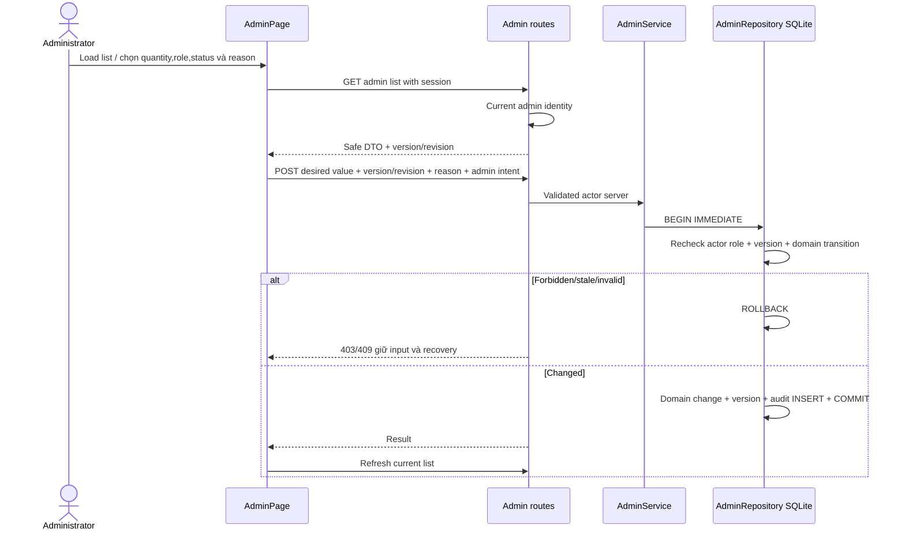

# E5 — quản trị vận hành, quyền và audit

Mở rộng vai trò admin theo yêu cầu ecommerce. Mốc này thực thi inventory, fulfillment, user-role management và audit; **chưa phải toàn bộ admin CRUD sản phẩm/variants**. Các ảnh/metadata catalog vẫn theo pending17; không ghi đè catalog/encoder để làm như metadata CRUD đã hoàn thiện.

## Quyền và bảo vệ transaction

Route `/admin` chỉ xuất hiện qua link trong tài khoản có role admin. Direct URL không tạo quyền: API resolve HttpOnly session và current role trong DB. Anonymous401, user403. Mutation cần JSON strict/extra-forbid, `X-Cortis-Intent: admin`, global Origin allowlist. Actor UUID lấy từ session, không nhận actor_id/role override trong query hoặc body. Mọi JSON no-store/request_id theo06.

AdminRepository mutation bắt đầu BEGIN IMMEDIATE và **kiểm lại role actor trong cùng transaction**. Nếu admin đã bị hạ quyền trước khi giành DB lock, từ chối403; không chỉ tin kết quả auth trước khi chờ. Thay đổi chính và audit INSERT commit/rollback cùng nhau. Không có API xóa/sửa audit. Thông báo successful no-op không khẳng định có event mới.

## API

GET lists offset0–1e6(default0),limit1–100(default20), unknown/duplicate params422. OpenAPI có params tương ứng.

| Method | Endpoint | Input/response chính |
| --- | --- | --- |
| GET | `/api/v1/admin/inventory` | q≤120 tên/SKU folded Vietnamese substring, items/total/offset/limit/revision |
| POST | `/api/v1/admin/inventory/{Pxxx}` | quantity0–1e6,revision0–1e9,reason; trả inventory product_id/quantity/revision |
| GET | `/api/v1/admin/users` | q≤120 email substring case insensitive; users/total/offset/limit |
| POST | `/api/v1/admin/users/{uuid}/role` | role user|admin,version0–1e9,reason; user public admin DTO |
| GET | `/api/v1/admin/purchases` | status optional processing|shipped|delivered|cancelled; orders snapshot summary/items, không address |
| GET | `/api/v1/admin/purchases/{ORD-id}` | detail/address để xử lý đơn, require admin; không user_id/customer_id |
| POST | `/api/v1/admin/purchases/{ORD-id}/status` | status shipped|delivered|cancelled,version0–1e9,reason |
| GET | `/api/v1/admin/audit` | events/total/offset/limit, không query raw credentials |

Integers strict: bool/string/float/negative/overflow rejects422. Reason NFC/trim/whitespace collapse,3–200 chars, không embedded control char. Không actor/password/hash/session/customer_id trong public users DTO. Admin users list có email/display_name/user_id/role/version vì đây là chức năng quản lý tài khoản được bảo vệ; không trả thông tin đó từ API customer order. Admin overview orders count gồm legacy JSON + ORD đã tạo, không chỉ30 seed.

## Inventory

List metadata hydrate từ validated ProductRepository và quantity từ ledger E4. Tìm tên/SKU tại Application, sort product_id stable, page sau filter; ledger revision global theo inventory_state. Inventory SKU đã không còn catalog có product=null, không sửa quantity qua API này. Catalog dependency missing503, SKU missing404. Không giả catalog unavailable thành missing product.

Set desired quantity yêu cầu exact revision. Checkout/cancel/admin khác làm revision thay đổi thì409 INVENTORY_CHANGED, UI giữ lỗi và cho explicit reload/review, không tự ghi lại quantity cũ. Thay đổi thực sự → set quantity+bump revision+audit inventory.set(before/after quantity). Same quantity/current revision → no-op không audit/revision bump. Chỉnh inventory không đổi seed JSON/model/index; các API public đọc cùng ledger.

## Fulfillment

Transitions: processing→shipped hoặc cancelled; shipped→delivered; delivered/cancelled terminal. Không skip processing→delivered hoặc reverse, không hủy đơn đã shipped/delivered. Stale version409 ORDER_CHANGED; transition sai409 ORDER_TRANSITION_INVALID; missing404 ORDER_NOT_FOUND. Same status là desired-state replay, trả current version mà không tăng stock/audit.

Admin cancellation processing hoàn lại từng line quantity và bump inventory revision trong cùng transaction với status/version/audit. Concurrent customer cancel/admin cancel không hoàn stock hai lần; customer cancel sau admin shipped bị từ chối. Demo delivered không tự mark COD paid: hiện chưa có xác nhận thu tiền/payment integration. Không xem trạng thái demo là bằng chứng hãng vận chuyển đã giao thật.

Order list không address; admin chủ động mở detail mới đọc thông tin nhận hàng. Detail customer vẫn owner-only, không dùng admin endpoint cho khách. Các seed O001 JSON không được mutation bằng admin ledger này; history cũ vẫn read-only theo contract.

## Quản lý role

Table admin_user_versions(user_id PK/FK,version) tách riêng account password/session schema để không phá insert accounts cũ. Roles chỉ user/admin. Kiểm version trước đổi, stale409 ACCOUNT_CHANGED. **Không tự đổi role của actor đang thao tác** (409 SELF_ROLE_CHANGE); giữ ít nhất một admin bằng guard LAST_ADMIN, không có endpoint xóa/disable admin ở mốc này. Khi role thay đổi: update role+bump version+revoke toàn bộ sessions target+audit account.role cùng transaction. Target cần đăng nhập lại mới dùng quyền mới. Same role/current version no-op. Không cho web signup chọn admin; bootstrap qua CLI explicit.

Account lock/unlock/delete/password reset/last-admin policy cho những thao tác đó còn pending, không mô phỏng bằng role user.

## Audit data

admin_audit: auto increment audit_id, actor_id FK,action,subject_id,before_json,after_json,reason,created_at UTC. Actions inventory.set/order.status/account.role. Không lưu passwords/tokens/địa chỉ/điện thoại/request bodies trong audit. Reason là ghi chú operator, UI cần tránh nhập secrets/PII không liên quan. List new-first stable audit_id, read-only. Đây là audit admin mutations, chưa phải event log tất cả customer actions hoặc external append-only/tamper-proof storage. Không claim chống DB operator sửa file trực tiếp.

## UI và test fixtures

AdminPage giữ Cortis stone/wine UI,4 mục inventory/orders/users/audit; paging/filter/search, labels, reason field, busy lock, error/retry/empty, address detail explicit open/close. Self-role controls disabled; API vẫn enforce độc lập. Role/stock/status version không lấy từ field user tự nhập. Token expired/permission removed dọn private data khỏi page, hiện login recovery. Tab/read requests abort khi unmount hoặc đổi điều kiện; không auto retry mutation. Page title tiếng Việt.

Browser E2E dùng `scripts/admin_browser_fixture.py` explicit provision, không startup auto seed. Chỉ nhận admin-e2e-* @example.test trong workspace này, random ephemeral passwords qua env, không in credential. Buyer fixtures cũng random passwords. AfterAll retire admin privilege/sessions của tất cả reserved fixtures, giữ rows để FK audit không bị xóa. Bootstrap/cleanup fixture là hành động CLI riêng, không chứng minh normal user có quyền cấp/hạ admin. Counts retirement check ở artifacts/backend/admin-fixture-retirement.json. Không commit runtime DB hoặc env.

## UML/code mapping

Application admin_service.py (catalog hydration/filter)→Data admin_repository.py (atomic SQL invariants/audit); Presentation admin.py strict schemas/actor/query; main DI. Tests test_admin_operations.py + admin.spec.ts. Mermaid không thay .vpp editable pending.

Evidence `artifacts/backend/ADMIN_OPERATIONS_REPORT.md`. E5 chưa complete: product metadata/asset CRUD + index rebuild/publication, variants/sizes, account lock/delete, returns/refund and reconciliation tooling, full data/frozen quality/.vpp/provider-specific live speech gates vẫn pending. Không mở public hoặc sửa Azure resource trong mốc này.
