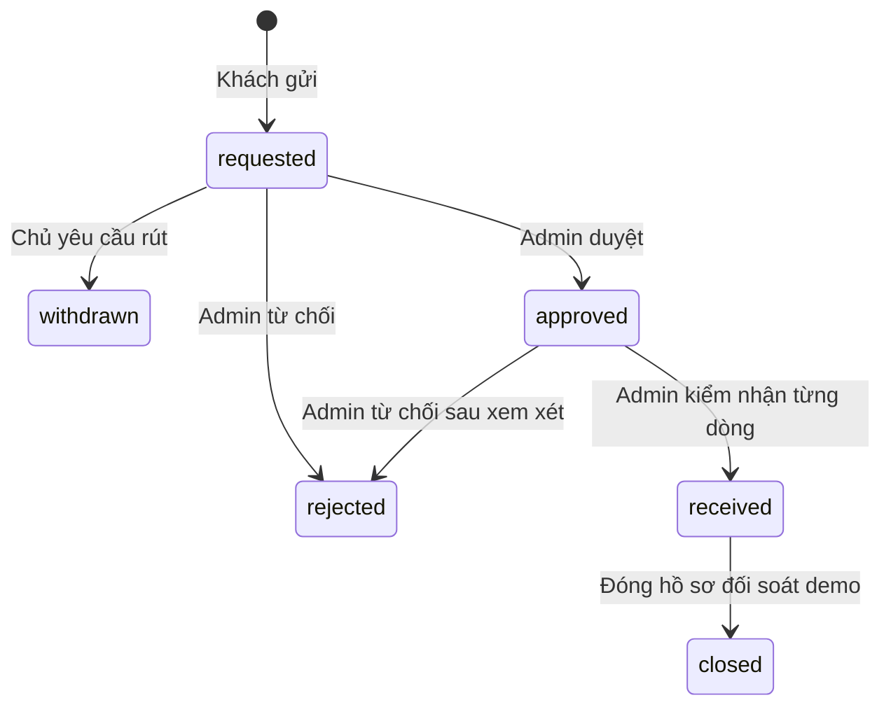

# Trả hàng từng phần và kiểm nhận kho

Mốc2026-10-15, basec9c6a1d. Vận hành trả hàng cho đơn COD demo tạo từ checkout. **Không chuyển tiền, hoàn tiền thật hoặc giao đổi sản phẩm.** Không thay model/vector hay ghi lên đơn legacy O001.

## Tham khảo và chính sách

[Shopify returns](https://help.shopify.com/en/manual/fulfillment/managing-orders/returns) và [refunding](https://help.shopify.com/en/manual/fulfillment/managing-orders/refunding-orders) tách trả hàng, nhập lại kho và refund; [Nike](https://www.nike.com/help/a/how-to-return) bắt đầu luồng từ lịch sử đơn. Chỉ tham khảo luồng, không sao chép thời hạn/quy định của các thương hiệu.

Chính sách **demo_returns_v1**: gửi trong30 ngày từ lúc xác nhận delivered, bao gồm đúng mốc hết hạn. Payload mới lưu delivered_at trong transaction giao hàng. Đơn cũ dùng timestamp audit delivered nếu có; thiếu mốc thì không tự suy từ ngày đặt và không đủ điều kiện. Chưa giao/hủy/ngoài hạn không được tạo hồ sơ.

Mỗi yêu cầu có1–100 dòng, quantity1–99, không lặp SKU. Tổng lượng requested/approved/received/closed cộng lần mới không vượt lượng đã mua. rejected/withdrawn giải phóng lượng giữ chỗ. Giá theo snapshot đơn, không theo catalog mới; không gồm phí giao hàng. Tối đa100 hồ sơ/order (vượt429 RETURN_LIMIT). Reason3–200 ký tự normalized/không control characters.

## Vòng đời và kho



Create/approve không tăng tồn kho. Khi received, admin gửi đúng mỗi SKU một lần với restock_quantity0..quantity. Chỉ phần đủ điều kiện bán lại được nhập kho; phần còn lại cách ly. UI mặc định0 để không giả định hàng trả đều bán lại được. Chỉ tăng revision kho nếu có lượng nhập>0. Retry cùng receipt không nhập lần nữa; receipt khác409 RETURN_RECEIPT_CONFLICT. Trạng thái terminal không quay ngược.

closed ghi refund_status=demo_recorded và refund_amount_vnd=merchandise_value_vnd. Đơn gốc vẫn delivered/payment_status=unpaid; không giả đã thu COD hoặc đã hoàn tiền. Đổi hàng và tiền thật còn pending.

## API và persistence

JSON có request_id/no-store, strict schema/extra-forbid. Cookie/Origin middleware giữ nguyên. Mutation user cần intent commerce; admin cần intent admin; Content-Type application/json. Query lạ/trùng422. IDs ORD-/RMA- +16 uppercase hex. Version strict integer0–1e9, quantity không nhận bool/string/float.

| Method | Endpoint | Hợp đồng |
|---|---|---|
| GET | `/api/v1/purchases/{ORD-id}/returns` | Owner; eligibility/items/remaining_quantity/deadline, returns,order_version |
| POST | `/api/v1/purchases/{ORD-id}/returns` | version của order,idempotency_key16–80,reason,items[{product_id,quantity}];201 return/replayed |
| POST | `/api/v1/returns/{RMA-id}/withdraw` | Owner,version; chỉ requested; return |
| GET | `/api/v1/admin/returns` | Admin; offset0–1e6 default0,limit1–100 default20,status optional; returns/total/offset/limit |
| POST | `/api/v1/admin/returns/{RMA-id}/status` | approved/rejected/received/closed,version,reason; receipt[{product_id,restock_quantity}] chỉ khi received |

DTO không có owner/customer/email/address/hash/idempotency_key. Đơn hoặc yêu cầu người khác404 kể cả admin dùng customer endpoint. Admin listing có gate riêng. Errors: ORDER_NOT_FOUND/RETURN_NOT_FOUND404; ORDER_CHANGED/RETURN_CHANGED, RETURN_INELIGIBLE, RETURN_QUANTITY_CHANGED, IDEMPOTENCY_CONFLICT, RETURN_TRANSITION_INVALID, RETURN_RECEIPT_CONFLICT, INVENTORY_UNAVAILABLE409; schema/receipt422.

Table purchase_returns(return_id PK,order_id FK,user_id FK,idempotency_key,request_hash,status,version,payload), UNIQUE(user_id,idempotency_key), index order_id. Startup chỉ CREATE IF NOT EXISTS. BEGIN IMMEDIATE bao ownership/version/window/cumulative quantities. Hash canonical gồm order/version/items sorted/reason normalized. Cùng key/nội dung trả hồ sơ hiện tại, cả sau hết hạn; cùng key khác nội dung409. Không tự retry hoặc tạo key mới khi kết quả chưa rõ.

Admin mutation kiểm lại role dưới write lock; stock/revision/receipt/status/version/audit commit hoặc rollback cùng nhau. Customer create/withdraw cũng có audit atomic. Retry đã đạt trạng thái không tạo audit/version/stock lần nữa. Kiểm nhận từng dòng không được thiếu/thừa/lặp, không restock vượt quantity.

## UI và UML

ReturnPanel ở đơn demo delivered: chọn quantity0 là bỏ qua, phải chọn ít nhất một dòng>0; hiển thị hạn/lượng còn lại/trạng thái/phản hồi/receipt/giá trị demo. Có rút yêu cầu đang chờ và tải lại trạng thái. Lỗi giữ input; mất phản hồi create khóa draft và cho kiểm tra lại nguyên body/key. Sau xác nhận mới cho yêu cầu tiếp. Browser test cho server ghi thật rồi bỏ phản hồi để kiểm luồng này.

`/admin/returns` từ navigation quản trị: lọc trạng thái/phân trang20, reason bắt buộc, duyệt/từ chối/kiểm nhận/đóng hồ sơ. Trạng thái/receipt/version lấy từ API, direct URL vẫn server auth. Presentation returns.py→Data ReturnRepository; main DI; không browser đọc DB/JSON nội bộ.

```mermaid
sequenceDiagram
  actor U as Customer
  participant UI as ReturnPanel
  participant API as Return routes
  participant DB as ReturnRepository SQLite
  actor A as Admin
  U->>UI: Chọn SKU/quantity/reason
  UI->>API: POST owned order/version/key/items
  API->>DB: BEGIN IMMEDIATE, ownership/replay/remaining/window
  DB->>DB: Insert request + audit, COMMIT
  API-->>UI: Return/replayed
  A->>API: Approve then receive with restock quantity per SKU
  API->>DB: Recheck admin/version/transition under lock
  DB->>DB: Stock + revision + receipt + audit, COMMIT
  A->>API: Close demo record
  API->>DB: Demo value + status + audit, COMMIT
  UI->>API: GET owned returns
  API-->>UI: Current state; no payment movement asserted
```

## Evidence và pending

[RETURNS_REPORT](../artifacts/backend/RETURNS_REPORT.md) và returns-verification.json/raw XML/browser JSON ghi lệnh/exit/fingerprints. Backend224 passed; targeted21 passed. Build/lint/17unit passed. Browser final functional2 passed (lost response/replay, withdrawal, partial restock/quarantine, closure, denial). DOM không overflow và admin content column≥260px tại360/768/1440.

Đã sửa selector trùng option/status và axe heading-order. Axe0 trên2 surfaces/3 widths **trước sửa CSS cuối**. Review ảnh phát hiện nội dung admin bị ép hẹp dù không overflow; đã sửa flex basis và kiểm width assertion trong functional run. Final screenshot/axe confirmation sau CSS vẫn pending; ảnh trước sửa chỉ lưu ignored local archive, không coi là final visual evidence. Không tiếp tục vòng polish mở.

Chưa complete tổng hệ thống: final visual confirmation, đổi hàng, payments/refunds thật, variants/sizes, metadata/assets CRUD/index publication, data/photo repair, frozen quality/provider-specific live speech, editable .vpp và clean checkout acceptance còn pending. Không coi test trả hàng là model/Groq/Azure verified.
