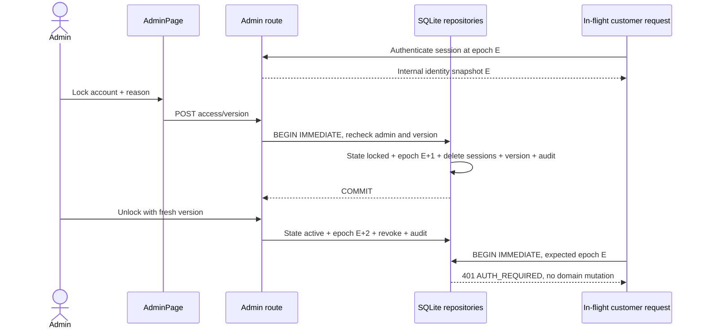

# Khóa/mở khóa tài khoản và thu hồi quyền ghi

Mốc2026-10-15, basea820ebd. Bổ sung quản lý access cho user/admin, giữ nguyên catalog, search/vector và COD demo. Đây là khóa có chủ đích bởi admin, độc lập với quota chống thử mật khẩu; không tự khóa tài khoản theo số lần login sai.

## Thiết kế và nguồn tham khảo

[OWASP Authentication](https://cheatsheetseries.owasp.org/cheatsheets/Authentication_Cheat_Sheet.html) hướng dẫn phản hồi đăng nhập chung cho thông tin sai hoặc tài khoản vô hiệu hóa; [OWASP Session Management](https://cheatsheetseries.owasp.org/cheatsheets/Session_Management_Cheat_Sheet.html) mô tả thu hồi/tạo lại phiên khi quyền thay đổi. Cortis tiếp tục dùng cookie opaque/HttpOnly và phiên lưu hash server-side.

Admin có thể chuyển active↔locked với lý do bắt buộc. Thay đổi trạng thái xóa mọi session của target trong cùng transaction. Unlock cũng xóa phiên, không khôi phục token cũ và không tự đăng nhập. Tài khoản locked login với đúng hay sai mật khẩu đều401 INVALID_CREDENTIALS, cùng thông báo chung như email không tồn tại. Hash mật khẩu vẫn được kiểm trước quyết định trạng thái; không tạo đường login bỏ qua hash cho account locked.

Admin không tự khóa tài khoản của phiên hiện tại (409 SELF_ACCESS_CHANGE); role/access không được loại bỏ admin hoạt động cuối cùng. Admin đã locked không được dùng các API quản trị. Khóa không đổi role, không xóa giỏ/yêu thích/đơn/hồ sơ trả hàng. Chuyển role cho target locked không tự mở khóa.

## Hợp đồng API

| Method | Endpoint | Request / response |
|---|---|---|
| GET | `/api/v1/admin/users` | q email substring và access_state optional active/locked; offset/limit như20; mỗi users row thêm access_state |
| POST | `/api/v1/admin/users/{uuid}/access` | JSON access_state active/locked,version strict integer0–1e9,reason3–200; trả request_id và user admin DTO |

Body extra-forbid, intent admin, JSON Content-Type, current admin identity và Origin allowlist. State bool/sai/rỗng, version bool/string/negative/overflow, reason control char hoặc query lạ/trùng422. Missing account404; non-admin403; no session401. DTO GET users/POST access gồm user_id/email/display_name/role/access_state/version. DTO auth/me/register/login giữ nguyên4 trường; không trả epoch/hash/session/customer_id ra browser.

Role và access dùng **cùng admin_user_versions.version**: thay đổi một trong hai làm mọi form cũ stale. Stale409 ACCOUNT_CHANGED, không tự retry ghi. Same state/current version là no-op, không bump/audit/revoke. Same state/stale version vẫn409 để không che một chuỗi lock→unlock→lock xen giữa. API mutation access không sửa password hay order state.

## Database và transaction

Thêm account_access(user_id PK/FK,state CHECK active|locked,epoch INTEGER>=0). Tài khoản chưa có row được hiểu active/epoch0; không ALTER hay đổi thứ tự7 cột accounts. CREATE IF NOT EXISTS hỗ trợ DB cũ và không mở khóa/reset epoch khi restart. Test upgrade dựng DB7 cột thực tế và kiểm giữ identity/hash/customer mapping/session hợp lệ; khóa sau nâng cấp vẫn bền qua restart.

Lock/unlock BEGIN IMMEDIATE: kiểm active admin/epoch, target, self guard, version, số active admin; upsert state, bump auth epoch, delete sessions, bump admin version và INSERT audit account.access, COMMIT. Bất kỳ lỗi audit làm rollback state/epoch/version và giữ phiên cũ. SQL parameterized. Không có API hard delete trong mốc này.

Epoch tăng cùng thu hồi phiên khi đổi role/access/password. Account snapshot lấy từ session có auth_epoch nội bộ. Mọi HTTP mutation được bảo vệ truyền epoch này qua Application vào Data; trước ghi, dưới write lock, kiểm account vẫn active và epoch còn khớp. Các luồng được bao gồm:

- profile/password/session issuance;
- cart/wishlist/quote/place/cancel;
- return request/withdraw;
- admin stock/role/access/order status/return status.

Vì vậy request đã xác thực trước lock rồi được xử lý sau unlock vẫn401 AUTH_REQUIRED. Không chỉ kiểm active tại thời điểm ghi. Cấp session cũng kiểm epoch dưới lock để snapshot login cũ không tạo token mới sau thay quyền/mật khẩu/lock-unlock. Đổi password trả snapshot mới ngay trong transaction để tránh đọc nhầm snapshot từ thay đổi đồng thời khác.

Epoch không là input client, không trong public DTO, không thay optimistic cart/order/inventory versions. Internal CLI/test có thể gọi repository với epoch optional nhưng vẫn luôn kiểm active; HTTP luôn truyền snapshot. Read đang chạy không bị cưỡng chế ngắt giữa chừng; các request mới phải resolve session hiện tại, còn mutation kiểm lại dưới lock. Logout vẫn cho xóa cookie/token ngay cả phiên đã hết hiệu lực.

## UI và UML

Tab Tài khoản trong `/admin` có trạng thái, lọc active/locked, nút khóa/mở khóa gắn đúng email và lý do chung. Disabled thao tác tự khóa. Busy guard chống double submit; lỗi stale giữ lý do, tải lại lấy version mới. Khi chuyển trạng thái khiến row rời bộ lọc, thông báo thành công và empty state vẫn rõ. Unlock yêu cầu khách đăng nhập lại; không báo password sai hay trạng thái private từ API login khác nhau.

## Evidence và phần còn thiếu

[ACCOUNT_ACCESS_REPORT](../artifacts/backend/ACCOUNT_ACCESS_REPORT.md) và account-access-verification.json ghi raw commands/exit/results/fingerprints. Tests kiểm session độc lập, generic login, preserved cart, shared versions, audit rollback, concurrent role/access,14 HTTP mutation interleavings sau lock-unlock, migration và stale password snapshot. Browser2 tests với API/SQLite thật kiểm hai phiên bị revoke, login/unlock, filter/audit, stale form và responsive360/768/1440/axe.

Không dùng các test này để claim model quality hoặc live speech. Xóa/anonymize tài khoản, variants/sizes, product metadata/assets CRUD/index publication, đổi hàng/refund integration, catalog repair, independent quality/provider-specific live evidence, editable .vpp và clean checkout acceptance vẫn pending. Visual confirmation cuối của module returns là gate riêng còn pending theo23; evidence giao diện account không thay gate đó.
