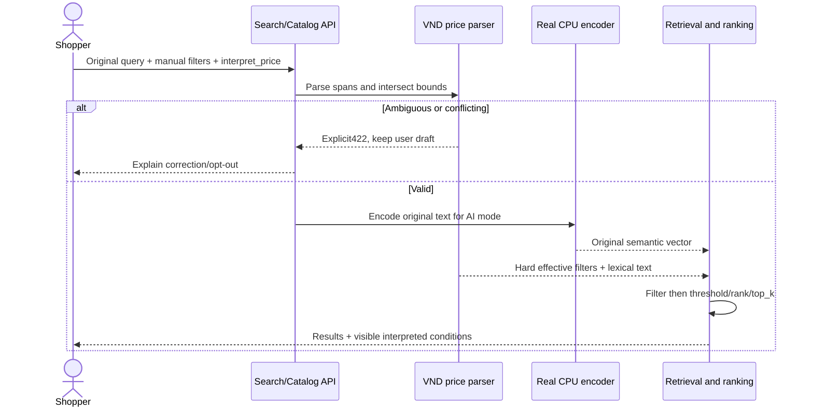

# Điều kiện giá trong mô tả tìm kiếm

Mốc2026-10-15, base8435660. Bổ sung parser VND có giới hạn cho catalog/suggestions và AI text/voice/multimodal. **Không phải bộ hiểu toàn bộ ngôn ngữ tự nhiên**, không phải STT, không thay encoder/vector hay giả điểm AI bằng keyword.

## Cơ sở thiết kế

[Elastic range query](https://www.elastic.co/docs/reference/query-languages/query-dsl/query-dsl-range-query) mô tả các biên gt/gte/lt/lte; [Boolean query](https://www.elastic.co/docs/reference/query-languages/query-dsl/query-dsl-bool-query) phân biệt lọc điều kiện với scoring. Cortis áp dụng nguyên tắc đó trên index hiện có, không thêm Elasticsearch. [Baymard query types](https://baymard.com/research-articles/ecommerce-search-query-types) là tham khảo về các thành phần ý định kết hợp trong truy vấn ecommerce, không phải bằng chứng chất lượng Cortis.

## Grammar được hỗ trợ

Parser `vi_vnd_price_v1` xử lý NFC/case/không dấu; giữ dấu số để không làm mất decimal/grouping. Numeric0–1e9 VND, các đơn vị nghìn/ngàn/k/thousand, triệu/tr/million, VND/đ/đồng/₫. VND có thể viết nhóm3 chữ số (`1.500.000`, `1,500,000`, `1 500 000`) hoặc số nguyên≥1000 không ghi đơn vị. Scaled unit chấp nhận phần thập phân1–2 chữ số (`1,5tr`, `1.25 triệu`); `1.500 triệu` bị từ chối vì mơ hồ.

Hỗ trợ số đọc tiếng Việt0–999 ở phần số, như một, mười lăm, hai mươi mốt, năm trăm, một trăm lẻ năm. Có rưỡi sau đơn vị nghìn/triệu với phần đầu nguyên; giá ghép như một triệu hai trăm nghìn/1tr500k. Các cụm sai như “một hai triệu” không được đoán thành số. Đây là xử lý transcript được nhập/sửa, không chứng minh speech provider nhận dạng đúng.

| Câu / toán tử | Biên trên giá nguyên VND |
|---|---|
| dưới/ít hơn/rẻ hơn/under/below/less than/`<` | max=ceil(amount)-1 |
| không quá/không hơn/không đắt hơn/tối đa/up to/at most/no more than/`<=`/`≤` | max=floor(amount) |
| trên/hơn/đắt hơn/over/above/more than/`>` | min=floor(amount)+1 |
| từ/ít nhất/tối thiểu/không dưới/không ít hơn/không rẻ hơn/from/at least/`>=`/`≥` | min=ceil(amount) |
| từ A đến/tới B, between A and B | min=ceil(A),max=floor(B), gồm hai biên |

Nếu khoảng chỉ ghi đơn vị ở một đầu, đầu kia dùng chung đơn vị (`từ500 đến1500k`=500k–1500k). Không đoán hai đơn vị khác nhau khi bị bỏ sót. UI luôn hiển thị giới hạn thực tế. Giá nhỏ hơn1000 không đơn vị yêu cầu làm rõ để tránh hiểu nhầm size/model. SKU như P001/Nike Air Max270 không bị fuzzy thành số tiền.

## Fail rõ thay vì tự đoán

- PRICE_QUERY_AMBIGUOUS422: giá không có so sánh, xấp xỉ, phủ định chưa hỗ trợ, nhiều khoảng nối hoặc/or/hay, numeric grouping mơ hồ hoặc số đọc sai. Ví dụ “khoảng1tr”, “dưới1tr hoặc trên2tr”.
- PRICE_QUERY_CONFLICT422: các biên trong câu không giao nhau hoặc không có VND hợp lệ (dưới0/trên1e9).
- PRICE_FILTER_CONFLICT422: điều kiện trong câu và bộ lọc đã chọn không có phần giao. Không ưu tiên một bên hay tự nới điều kiện.
- PRICE_VALUE_UNSUPPORTED422: giá âm/ngoài0–1e9.
- PRICE_CURRENCY_UNSUPPORTED422: USD/EUR/GBP/JPY, dollar/euro hoặc ký hiệu ngoại tệ đã nhận biết. Không tự đổi tỷ giá.

Đây là grammar hữu hạn. Cách viết ngoài grammar có thể chưa được nhận biết; applied=false không có nghĩa câu đã được hiểu hết. Phủ định thuộc tính, size/brand intent, khoảng xấp xỉ và mọi biến thể ngôn ngữ còn cần triển khai/đánh giá. Có lựa chọn tắt parser để tìm literal/semantic như trước; không coi opt-out là giá đã được bảo đảm.

## Pipeline và API

SearchOptions thêm `interpret_price: StrictBool=true`; catalog/suggestions nhận query `interpret_price=true|false` defaulttrue, duplicate/giá trị khác422. Mode image không diễn giải vì không có text. Voice dùng transcript cuối đã xác nhận; không gọi provider trong parser.

API search validate parser/merge trước khi build encoder (khi model đã sẵn sàng). Encoder vẫn encode **nguyên câu gốc** để giữ semantic cosine/scoring policy. Giá hard filter được áp dụng trước threshold/ranking/top_k. BM25 dùng lexical_text đã bỏ các span điều kiện giá, giữ tên/mã/thuộc tính. RRF/cosine vẫn riêng; exact SKU sau bỏ span giá vẫn phải đạt hard filters và threshold. Không tái đưa SKU vượt ngân sách vào kết quả.

Effective filters = giao của inferred min/max và manual min/max; các filter category/brand/color/stock giữ nguyên. `query.options`/catalog `query.filters` vẫn echo điều kiện người dùng gửi, không giả frontend đã chọn giá suy ra. Response thêm `meta.price_interpretation` (search) hoặc `price_interpretation` (catalog): enabled,parser_version,applied,clauses[{text,min_price,max_price}],inferred_filters,effective_filters,lexical_text.

Catalog áp dụng giá trước facets/sort/pagination; câu chỉ có giá có thể browse toàn bộ tập đủ giá. Suggestions cũng giữ giới hạn giá khi bật parser. Query input không đổi thành regex/SQL. Parser chỉ làm việc trên chuỗi≤500 ký tự, không tải mạng/model/provider. Lexical fingerprint đổi sang bm25_vi_alias_typo_v2_price gồm parser version; index/model fingerprints và cosine scoring không đổi. Evidence cũ không được tự coi là frozen quality cho semantics mới.

## UI và UML

Search/catalog có checkbox “Tự hiểu điều kiện giá trong mô tả”; search áp dụng ở lần tìm tiếp theo, catalog lưu opt-out vào URL và cập nhật ngay. Notice ghi nguyên span đã hiểu và giới hạn thực tế; manual inputs không bị tự ghi đè. Lỗi giữ text/giá để sửa. Checkbox catalog phản hồi local ngay và đồng bộ với URL/Back, tránh checkbox controlled bị bật lại trong navigation bất đồng bộ; áp dụng cả checkbox tồn kho.

## Evidence và pending

[PRICE_QUERY_REPORT](../artifacts/backend/PRICE_QUERY_REPORT.md) và price-query-verification.json lưu lệnh thực chạy, exit, source SHA256 và raw stats. Full308 passed trước bổ sung số đọc tiếng Việt; final144 search/API/catalog tests passed sau bổ sung. Real CPU encoder39 property checks đạt, gồm word amounts và cosine invariant ởtext/voice/multimodal/image; manual transcript không phảiSTT. Browser3 price tests +1 word transcript test +13 catalog regression đạt ở các lần riêng. Hai batched visual rounds, axe0/no overflow search/catalog tại360/768/1440; không claim final full4-test suite đã chạy chung.

Không nghiệm thu toàn ecommerce: variants, catalog CRUD/index publication, ảnh/metadata còn sai, broader intents/negation, frozen independent Hit@K/OOD, speech provider regression, exchange/refund integrations, editable UML và clean-checkout acceptance vẫn pending; returns visual gate theo23 là riêng.
