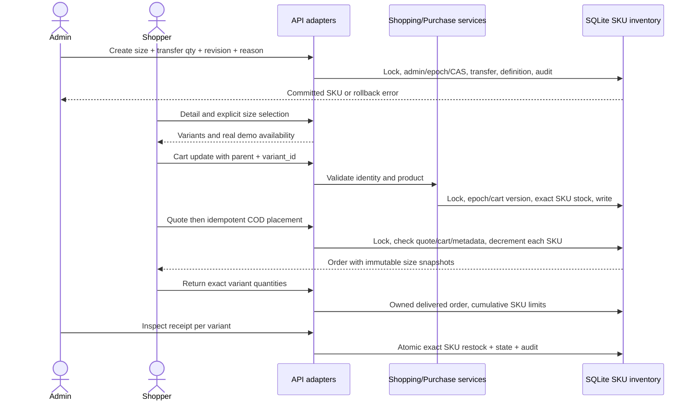

# Biến thể kích cỡ và tồn kho SKU

Mốc 15/10/2026, base `bfec727`. Bổ sung size có định danh riêng qua toàn bộ giỏ → báo giá → COD → hủy → trả hàng → kiểm nhận. Đây là một phần của E3/E5; chưa hoàn thành quản lý sản phẩm, biến thể màu/ảnh, giá riêng từng biến thể hoặc size guide có số đo thật.

## Cơ sở và dữ liệu

[Shopify ProductVariant](https://shopify.dev/docs/api/admin-graphql/latest/objects/ProductVariant) tách phiên bản sản phẩm theo các lựa chọn như size/màu. [Variant selectors](https://shopify.dev/docs/storefronts/themes/product-merchandising/variants) mô tả lựa chọn không có tổ hợp hợp lệ. Cortis áp dụng định danh SKU và không tự đổi sang size khác khi size được chọn hết hàng. Không sử dụng API/giá/chính sách Shopify làm dữ liệu bán hàng thật.

Ảnh và metadata catalog gốc không đổi; toàn bộ ảnh vẫn là ảnh thật có manifest. Giá/tồn kho/kích cỡ được gắn nhãn demo. Không suy ra size, độ vừa vặn hoặc số đo cơ thể từ ảnh. Màu và giá của size kế thừa sản phẩm; chưa tạo lựa chọn màu mới khi chưa có ảnh/provenance đúng màu.

SQLite thêm `product_variants(variant_id PRIMARY KEY,product_id,size,UNIQUE(product_id,size))`. SKU size là `P041-M`, `P001-40`. Tên cột lịch sử `inventory.product_id` và `cart_items.product_id` vẫn giữ để không rewrite DB đang dùng, nhưng **giá trị trong hai cột là khóa SKU**. API luôn tách `product_id` cha và `variant_id`; không gửi SKU vào đường dẫn product detail/media. Dòng không phân cỡ có khóa SKU bằng product_id, giữ nguyên mọi cart/order/return cũ.

`size` thuộc XS/S/M/L/XL/XXL/3XL cho áo thun/áo khoác; 34–48 cho nhóm giày/dép; ONE cho phụ kiện. Đây là quy ước demo, không phải bảng size của thương hiệu hoặc khẳng định phụ kiện có size thực ONE. Chưa có nhập bulk, sửa/xóa size, size quốc tế/half-size hoặc giá riêng.

## Phân kho có chủ đích

Không tự chia tồn kho cũ theo size khi khởi động. Với sản phẩm chưa khai báo size, kho gốc vẫn bán như trước. Admin tạo size và chuyển số lượng từ kho gốc trong một `BEGIN IMMEDIATE`: kiểm active/epoch/role, revision, size hợp lệ/không trùng, giảm kho gốc đủ số lượng, tạo definition/kho SKU, tăng revision, audit `variant.allocate`. Lỗi bất kỳ rollback cả audit và kho. Cho phép tạo size tồn0 để thể hiện hết hàng.

Khi có size đầu tiên, kho gốc trở thành **chưa phân cỡ**, không được tính là hàng bán. Chỉ tổng kho các size xuất hiện trong stock/in_stock public. Admin vẫn thấy/điều chỉnh kho gốc để phân tiếp. Không biến số còn lại thành size ngẫu nhiên. Cart/báo giá chưa phân cỡ cũ phải được sửa; cart hiển thị VARIANT_REQUIRED, có thể xóa dù mã không còn bán. Đơn cũ vẫn hủy/trả về kho gốc, không mất snapshot và không làm tăng một size tùy ý. Restart không reset số lượng hoặc seed lại size.

## API và invariants

| Endpoint / contract | Thay đổi |
|---|---|
| POST `/api/v1/admin/products/{product_id}/variants` | `size`, `quantity` số nguyên0–1e6, `revision`, `reason`; intent admin + JSON + role/epoch. 201 variant/product_id/size/quantity/revision. 409 INVENTORY_CHANGED/VARIANT_EXISTS/INSUFFICIENT_STOCK; 422 SIZE_UNSUPPORTED; không auto retry. |
| GET `/api/v1/admin/inventory` | Rows theo SKU ở product_id lịch sử, thêm size nullable; product summary tham chiếu product cha. Kho gốc và các size là các dòng riêng, cùng revision. |
| POST `/api/v1/admin/inventory/{sku}` | Nhận SKU `Pnnn` hoặc `Pnnn-SIZE`; chỉ sửa đúng kho đó, có CAS/epoch/audit. Không cập nhật tổng rồi suy chia. |
| GET `/api/v1/products/{product_id}` | Thêm variants[{variant_id,size,color,price_vnd,stock_quantity,in_stock}], dùng một stock snapshot/revision; default có size=null. |
| ProductSummary | Thêm sizes[] và available_sizes[]; available chỉ gồm size tồn>0; các trường cũ giữ nghĩa. |
| POST `/api/v1/cart/items` | Thêm variant_id nullable/optional. Có size phải chọn rõ, kể cả chỉ có1 size. Default cũ có thể bỏ trường. Quantity0 được xóa SKU discontinued. Parent/SKU không khớp422; không có/không thuộc biến thể409. |
| Cart | Thêm variant_id và size nullable cho từng dòng. Hai size cùng product_id là hai dòng, tối đa100 SKU, mỗi SKU≤99. Kiểm tồn kho cụ thể trong cùng write lock; cart không reserve. |
| Quote/order items | Size rows thêm variant_id,size,color snapshot; quantity/name/price/tổng vẫn server authoritative. Default rows cũ giữ nguyên shape. |
| Return request / receipt | Thêm variant_id optional. Giới hạn cumulative, duplicate, receipt đủ/không lặp và restock dùng SKU, không gộp theo product cha. Không có variant_id cho dòng size sẽ bị từ chối. |
| GET `/api/v1/catalog` | Thêm size strict canonical; facets.size với counts trước pagination, disjunctive. size+in_stock=true yêu cầu **chính size đó** còn hàng. Size không có trong catalog trả empty, không bỏ filter. |
| SearchOptions.filters | Thêm size strict canonical, áp dụng ở text/voice/image/multimodal trước threshold/rank/Top-k. Chưa suy size từ câu tự nhiên. |

Checkout đọc lại SKU/size/stock dưới write lock; nếu admin phân cỡ sau báo giá cũ thì từ chối trước khi trừ kho. Hai size không ghi đè nhau trong cart comparison/order/return maps. Hủy khách/admin và nhận hàng trả cộng đúng SKU đúng một lần; receipt không đủ hoặc khác parent không được ghi nhận. Hai người tranh SKU cuối chỉ một đơn thành công; failure giữa hai size rollback toàn bộ. Idempotency cũ/epoch guards vẫn áp dụng; không tự chọn size thay thế.

Stock snapshot và size metadata đọc trong cùng transaction cho AI/browse. Model/catalog/index fingerprint không đổi vì product embedding không chứa size/giá/tồn kho. Runtime inventory_revision bao gồm thay đổi definition/stock size. Cosine giữ nguyên; không tuyên bố independent quality mới đạt chỉ vì hard filters đúng.

## UX và UML

Trang chi tiết yêu cầu chọn size, hiện số lượng/hết hàng theo lựa chọn, reset quantity khi đổi size; không auto chọn size còn hàng khác. Giỏ/checkout/đơn/trả hàng hiển thị cỡ trên từng dòng và có DOM key/input ID theo SKU. Wishlist vẫn lưu product; thêm sản phẩm có size sẽ chuyển sang detail để chọn. Catalog lưu size trong URL và có clear/recovery như bộ lọc khác; AI có control size riêng và chip điều kiện. Size demo chưa có hướng dẫn số đo, UI nói rõ giới hạn.

Admin mở phần “Phân hàng sang kích cỡ” tại kho gốc, chọn size/quantity/reason; CAS lỗi có reload, dữ liệu không bị ghi đè âm thầm. Giao diện kế thừa Cortis; không đổi visual world.

Mapping: `data/variant_repository.py` chứa định danh và stock views; `PurchaseRepository` bootstrap/schema/transactions; ShoppingService/PurchaseService/AdminService nối metadata; routes shopping/admin/returns/main validate và hydrate; CatalogSearch/SearchService áp dụng size filter. Browser không đọc SQLite/JSON nội bộ. Editable Visual Paradigm vẫn pending.

## Bằng chứng và phần còn lại

Lệnh, source hashes, kết quả và phạm vi xem [VARIANTS_REPORT](../artifacts/backend/VARIANTS_REPORT.md). Tests SQLite không phải encoder evidence; browser/CPU encoder ghi riêng, voice manual transcript không phải Groq/Azure STT. Runtime demo P041-M/L được phân từ kho có sẵn bằng admin UI; restart giữ DB, clean checkout chưa có variant demo sẵn cho tới thao tác admin.

Vẫn cần product/asset CRUD và publication đồng bộ index, variant màu với ảnh đúng, variant price, size guide/half-size và dữ liệu merchandising đầy đủ; frozen independent relevance, provider speech, payment/refund thật, clean-checkout/UML/full-system acceptance. Không đánh dấu E3/E5 hoặc toàn goal complete từ milestone này.
