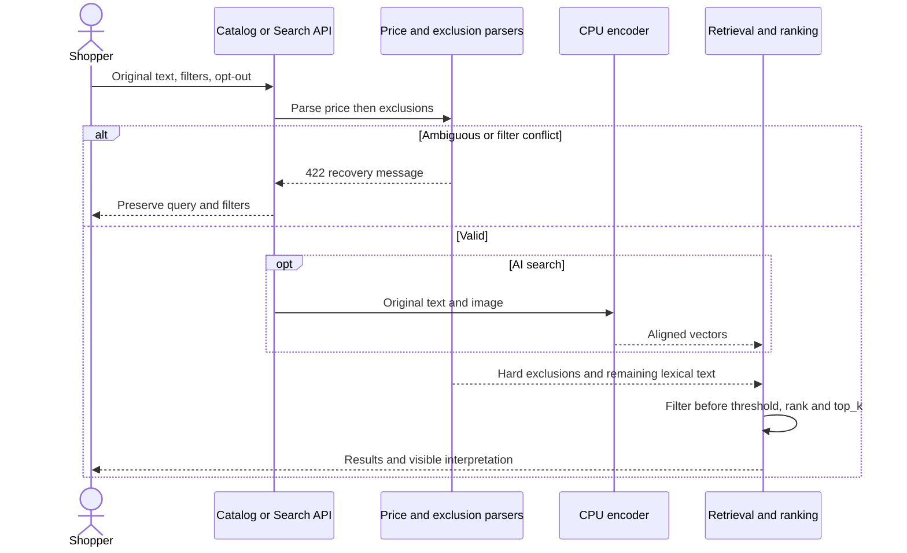

# Loại trừ metadata trong tìm kiếm

Mốc2026-10-15 nối tiếp [16](16_SEARCH_BROWSE.md), [25](25_PRICE_QUERY.md), [28](28_CATALOG_PUBLICATION.md). Thanh toán giữ COD/demo theo ưu tiên mới.

Trước đây “không đỏ” vẫn đưa từ đỏ vào BM25/embedding. Nay ExclusionInterpreter tạo hard metadata constraints, loại ứng viên trước threshold/fusion/sort/top_k/pagination. Encoder thật vẫn nhận nguyên mô tả theo hợp đồng vector; BM25 nhận từ khóa còn lại sau tách giá và loại trừ. Parser không gọi mạng/model/provider.

## Grammar

Tiền tố: không, không phải/chọn/lấy/muốn/cần/thích, trừ, ngoại trừ, loại trừ, not, without, except, excluding, exclude. Có thể thêm tên trường màu/color, hãng/thương hiệu/brand, loại/danh mục/category. Hỗ trợ dấu/không dấu/hoa thường/NFC. Ví dụ `áo thun; không màu đỏ và đen; dưới 1 triệu`, `ngoại trừ thương hiệu New Balance`, `trừ áo khoác`, `not color red or black`.

Danh sách cùng trường nối và/hoặc/hay/and/or/dấu phẩy loại từng giá trị: sản phẩm khớp bất kỳ giá trị nào đều bị loại. Nhiều trường dùng câu riêng như `không đỏ; trừ Nike`. Hãng so metadata không phân biệt hoa thường, category dùng lexical aliases; không fuzzy-correct entity loại trừ. Màu kiểm tra cụm từ trong trường color, không dò tên/mô tả/ảnh: loại đỏ cũng loại đen và đỏ rượu; loại đỏ rượu chỉ loại cụm cụ thể. blue→xanh dương, green→xanh lá; không đoán metadata chỉ ghi xanh.

Câu chỉ có loại trừ duyệt tập còn lại. Facets/suggestions cũng dùng tập đã loại trừ; giữ filter giá/size/stock thủ công. Filter chọn đúng giá trị bị loại trả422 EXCLUSION_FILTER_CONFLICT, field filters.<field> hoặc options.filters.<field>. Entity không rõ sau toán tử tường minh/tên trường, mixed-field list, double negation, entity trùng nhiều trường không chỉ rõ và boolean có ngoặc trả422 EXCLUSION_QUERY_AMBIGUOUS. Không flatten ngoặc. Phần dương sau điều kiện nên ngăn bằng chấm phẩy hoặc nhưng/but; không tự hiểu not Nike Air là loại toàn hãng Nike.

Áo không tay/túi không thấm nước giữ nguyên semantic text. Phủ định đơn lẻ không nhận ra entity có thể giữ nguyên văn và không báo đã hiểu. Đây là grammar giới hạn; positive category/brand intent, nested boolean, material/size inference và ngôn ngữ tự nhiên rộng hơn còn pending. Parser tối đa500 ký tự; lexical vẫn64 từ. Không chạy input thành SQL/regex. Publication tạo interpreter từ metadata mới, không hardcode hãng mới.

## API và UI

SearchOptions thêm strict boolean interpret_exclusions=true, độc lập interpret_price. Catalog/suggestions thêm query parameter interpret_exclusions=true|false, cấm duplicate hoặc boolean giả1. False giữ nguyên câu cho lexical/AI và không suy exclusions; filter thủ công vẫn áp dụng. Image-only không suy exclusions khi không có text.

Search thêm meta.exclusion_interpretation, catalog thêm exclusion_interpretation:

```json
{"enabled":true,"parser_version":"metadata_exclusions_v1","applied":true,"clauses":[{"text":"không màu đỏ","field":"color","value":"đỏ"}],"lexical_text":"áo thun"}
```

field chỉ brand/color/category; category là code, màu/hãng là canonical value. text là span nguyên bản đã NFC. lexical_text ở đây sau cả price parsing; price_interpretation.lexical_text vẫn trước bước exclusions. Lexical fingerprint đổi bm25_vi_alias_typo_v3_exclusions gồm parser version; model/index/cosine fingerprints không đổi. Relevance evidence cũ không chứng minh quality của semantics mới.

UI checkbox “Tự hiểu loại trừ màu, hãng, danh mục”, notice hiển thị điều kiện áp dụng; lỗi giữ truy vấn/filter. Catalog lưu opt-out trong URL, đồng bộ Back/Forward và suggestions. Search áp lựa chọn ở lượt kế tiếp; kết quả hiện tại thuộc lượt trước. Giữ style Cortis và components hiện có, không thêm CSS.



Tham khảo [Elastic bool query](https://www.elastic.co/docs/reference/query-languages/query-dsl/query-dsl-bool-query): filter/must_not không đóng góp score; áp dụng nguyên tắc, không thêm Elasticsearch dependency. [Baymard query types](https://baymard.com/research-articles/ecommerce-search-query-types) định hướng exact/product-type/feature search, không phải evidence parser. [EXCLUSIONS_REPORT](../artifacts/backend/EXCLUSIONS_REPORT.md) tách doubles, CPU thật và browser thật. Manual transcript không phải STT/Groq/Azure; multimodal chỉ property smoke, không phải independent relevance quality. Không đánh dấu ecommerce complete.
