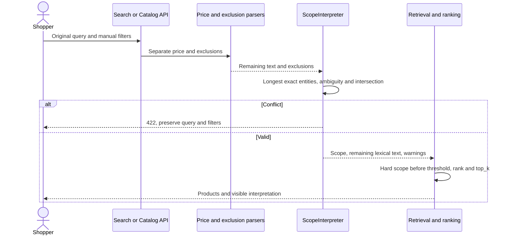

# Phạm vi hãng và loại sản phẩm trong mô tả

Mốc2026-10-15, bổ sung [16](16_SEARCH_BROWSE.md), [25](25_PRICE_QUERY.md), [29](29_SEARCH_EXCLUSIONS.md). Thanh toán giữ COD/demo; ưu tiên tìm kiếm và quản lý sản phẩm.

## Hành vi và thuật toán

“Áo thun Nike” phải đồng thời đúng hãng và loại, không chỉ tăng điểm cho từ Nike/áo thun. ScopeInterpreter nhận metadata hãng hiện tại và aliases category, nhận diện exact token phrases theo thứ tự dài trước, không fuzzy-correct điều kiện cứng. Nhiều giá trị cùng trường nối trực tiếp bằng hoặc/hay/or là union; hai trường hãng/category là intersection. Ví dụ `giày chạy bộ Nike hoặc Asics` giữ running_shoes và một trong hai hãng. Query chỉ có hãng/category vẫn duyệt đầy đủ tập phù hợp, không dựa vào số lần tên hãng xuất hiện trong description.

Trình tự chung: parse giá → parse loại trừ → scope trên phần còn lại → kiểm tra conflict → hard metadata filtering → threshold/ranking/sort/top_k/pagination. Catalog facets và suggestions cùng giữ scope. Brand/category scopes không ghi đè filter thủ công. Manual filter trái scope trả422 SCOPE_FILTER_CONFLICT, field filters.brand/category hoặc options.filters.brand/category. Nếu toàn bộ hãng/category đã chọn lại bị loại trừ, trả422 SCOPE_EXCLUSION_CONFLICT tại q/text. Một lựa chọn trong union bị loại vẫn giữ lựa chọn còn lại.

Scope bỏ span hãng/category khỏi lexical text; original text vẫn giữ để encode CPU và echo request. Vì vậy `áo thun Nike P999` còn exact SKU P999 và trả rỗng, không trả sản phẩm Nike khác để thay mã không có. SKU riêng lẻ, spelling correction và RRF/cosine contract cũ giữ nguyên. Publication tạo lại scope lexicon từ catalog mới.

Khi phần còn lại chỉ là các từ yêu cầu như “tôi muốn mua một chiếc”, bỏ phần filler này để duyệt đầy đủ scope; không bỏ thuộc tính/mã sản phẩm còn lại để ép kết quả.

Phạm vi mơ hồ không tự ép filter: `Nike hoặc áo thun`, `Nike Adidas`, `áo thun và áo khoác`, so sánh giống/like/vs/versus/instead, phủ định chưa được xử lý. Khi có ambiguity toàn scope bị bỏ, response có warnings, lexical/semantic nguyên văn và filter thủ công vẫn hoạt động. Không gộp các nhánh khác trường thành phép AND sai. Hãng ngắn như On cần `hãng On`/`brand On`, tránh nhận nhầm giới từ. Hãng trùng từ màu cơ bản cần brand marker. Chỉ exact entities đã biết, không bảo đảm đọc mọi tên model/material/size hoặc boolean lồng nhau. Màu dương chưa tự trở thành hard constraint. Query tối đa500 ký tự, lexical64 từ như trước; parser không mạng/model/provider/SQL/raw regex execution.

## API, UX và fingerprint

SearchOptions thêm strict boolean interpret_scope=true; catalog/suggestions thêm query parameter interpret_scope=true|false, cấm duplicate/boolean1. Image-only không suy scope khi không có text. False không áp scope, không báo warnings và giữ lexical text; các price/exclusion/manual filters độc lập vẫn áp dụng.

Search thêm meta.scope_interpretation; catalog thêm scope_interpretation:

```json
{"enabled":true,"parser_version":"brand_category_scope_v1","applied":true,"clauses":[{"text":"Nike","field":"brand","value":"Nike"},{"text":"áo thun","field":"category","value":"t_shirt"}],"lexical_text":"","warnings":[]}
```

Clauses có field brand/category, category là code. text là span nguyên bản NFC của entity. Không expose DB/path/identity. Lexical fingerprint đổi bm25_vi_alias_typo_v4_scope gồm parser version; model/index/cosine fingerprints không đổi. Historical quality policy không tự chứng minh phạm vi semantics mới đã đạt independent relevance gate.

Checkbox “Tự hiểu hãng và loại sản phẩm” độc lập giá/loại trừ; notice ghi phạm vi và warnings. Catalog lưu opt-out vào URL, hỗ trợ Back/Forward và suggestions. Search giữ lựa chọn draft tới lượt tìm tiếp theo; lỗi giữ query và filter để sửa, không tự nới ràng buộc. Dùng tokens/components Cortis hiện có; không thêm CSS.



Code: application/scope_query.py, CatalogSearch, SearchService; presentation/catalog.py; ScopeInterpretationNotice, SearchPage/BrowsePage. Mermaid không thay VP editable.

[Baymard category scopes](https://baymard.com/research-articles/autodirect-searches-matching-category-scopes) chỉ ra việc tìm product type nên giữ trải nghiệm phạm vi/category hữu ích. Áp dụng nhận diện và notice, không redirect tự động hoặc thêm Elasticsearch. Đây là nguồn định hướng UX, không phải evidence model của ứng dụng. [SCOPE_REPORT](../artifacts/backend/SCOPE_REPORT.md) tách doubles/browser/CPU thật, giới hạn relevance và các gate pending.
