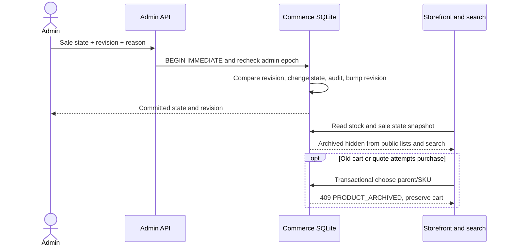

# Tạm ngừng bán và mở bán lại sản phẩm

Mốc2026-10-15 nối tiếp [26](26_PRODUCT_VARIANTS.md), [27](27_CATALOG_AUTHORING.md), [28](28_CATALOG_PUBLICATION.md). Ưu tiên quản lý sản phẩm và tìm kiếm; thanh toán vẫn COD/demo.

## Hợp đồng nghiệp vụ

Sản phẩm đã xuất bản có sale_state active hoặc archived. Thiếu bản ghi trạng thái nghĩa là active để migration giữ hành vi cũ. Sản phẩm mới chỉ có draft chưa có trạng thái bán, không thể archive/restore trước publication. Tạm ngừng bán là thao tác có thể khôi phục; không xóa ảnh, catalog, tồn kho SKU, cart/wishlist hay lịch sử đơn hàng.

- Archived bị loại khỏi products list, catalog, facets counts, suggestions và mọi mode tìm kiếm trước ranking/top_k. Sản phẩm active hết hàng vẫn hiện bình thường khi không lọc còn hàng; archive khác stock0.
- URL chi tiết và media/credits vẫn truy cập được: hiển thị “Sản phẩm tạm ngừng bán”, sale_state archived, in_stock false, public stock_quantity/variant quantities0, available_sizes rỗng. Đây là lựa chọn Cortis để phục vụ link đã lưu/lịch sử, không phải xóa tài nguyên hay bí mật hóa ảnh. Admin inventory vẫn thấy số lượng thật và sale_state.
- Cart đã có sản phẩm giữ dòng và giá để người dùng xử lý; issue PRODUCT_ARCHIVED, available_quantity0, checkout bị chặn. Xóa dòng quantity0 vẫn được. Wishlist giữ sản phẩm và trạng thái ngừng bán; có thể lưu/bỏ lưu để theo dõi, không thể thêm vào giỏ. Mở bán lại dùng số lượng thực tế hiện tại, không tự nhập kho/reset size.
- choose() kiểm tra sale state trong transaction cart/quote/place, bao gồm tất cả size của parent. Archive sau application precheck vẫn bị chặn khi commit mutation. Báo giá lấy trước archive không thể tạo đơn khi archived. Restore có thể dùng lại quote chưa hết hạn nếu cart/price/stock vẫn đúng theo contract cũ; không tự tiêu idempotency key cho request thất bại.
- Đơn đã đặt giữ snapshot/ownership; detail, idempotent replay, cancel/return/restock không bị đổi thành sản phẩm mất dữ liệu. Replay vẫn trả201 với replayed=true theo API đã có, không tạo đơn/trừ kho mới. Restock khi archived vẫn cộng đúng SKU trong kho thật, không tự mở bán.
- Mở bán/ngừng bán không đổi catalog/model/index fingerprints hoặc vectors; state là operational filter như stock, inventory_revision tăng khi thay đổi. Index product_count vẫn là số encoded catalog records, không phải số đang bán.

## API, persistence và concurrency

POST /api/v1/admin/products/{Pnnn}/sale-state, admin role + X-Cortis-Intent:admin + application/json:

```json
{"sale_state":"archived","revision":0,"reason":"Kiểm tra dữ liệu sản phẩm"}
```

Strict DTO: sale_state chỉ active/archived, revision strict integer0..1e9, reason chuẩn ChangeReason3..200 ký tự, cấm field lạ. Response availability chứa product_id/sale_state/revision. Cấm variant ID tại route này,404 nếu chưa xuất bản/không tồn tại.

SQLite product_availability(product_id PK,sale_state CHECK) lưu cùng DB commerce. BEGIN IMMEDIATE recheck admin role/access epoch → kiểm tra inventory_revision CAS → đổi state → tăng revision → audit product.sale_state(actor,before,after,reason), commit cùng nhau. Audit lỗi rollback toàn bộ. No-op cùng state/revision không tăng revision hoặc thêm audit; stale revision vẫn409 INVENTORY_CHANGED, kể cả no-op. Stock/archive cạnh tranh cùng revision chỉ một mutation thắng. Dùng revision toàn kho nên thay đổi sản phẩm khác cũng có thể yêu cầu reload; không ghi đè âm thầm.

PurchaseRepository.snapshot_catalog đọc stock/revision/sizes/archived trong cùng read transaction, mask public sellable quantities nhưng giữ kho thật. snapshot_with_variants/snapshot cũ giữ tuple contract; VariantRepository.sale_detail bổ sung trạng thái cùng snapshot, detail cũ vẫn cho kho thật ở tầng Data. Main, CatalogSearch, SearchService và ShoppingService dùng view phù hợp. Không cache sale state trong catalog hoặc ghi vào seed JSON/NPZ. Publication/edit draft không tự đổi operational state.

Public product summary/detail thêm sale_state active/archived. Admin draft detail thêm sale_state(active/archived/null), inventory_revision; list thêm sale_state mỗi item và inventory_revision. Admin products status filter giữ draft/live và thêm active/archived; live là đã xuất bản, bao gồm cả archived. Không đổi draft version khi chỉ đổi trạng thái bán.

## UI và UML

Admin→Sản phẩm→mở mã đã xuất bản→Trạng thái bán: nút ngừng/mở bán, xác nhận inline, lý do bắt buộc, loading/disabled, lỗi giữ nội dung và reload conflict. Dirty metadata phải lưu hoặc bỏ trước; trạng thái bán không xuất bản draft. Danh sách có filter mở bán/ngừng bán và nhãn; trang chi tiết/wishlist/cart thể hiện recovery rõ. Dùng components/tokens Cortis hiện có, không thêm CSS.



Code: data/product_availability.py, variant/purchase/admin repositories; application services; presentation/admin.py/main; AdminCatalogPanel/ProductShopping/ShoppingPages/ProductPage. Source UML bổ sung, không thay VP editable.

[Shopify archive/unarchive](https://help.shopify.com/en/manual/products/add-update-products) tham khảo việc archive có thể khôi phục thay xóa vĩnh viễn. Cortis mở bán lại bằng xác nhận active độc lập draft; Shopify unarchive về Draft, không khẳng định hai luồng giống nhau. [PRODUCT_AVAILABILITY_REPORT](../artifacts/backend/PRODUCT_AVAILABILITY_REPORT.md) tách SQLite/doubles/browser/CPU thật; không phải hoàn thành toàn ecommerce. Bulk archive, schedule, per-channel visibility, hard delete, màu/giá theo variant, catalog repairs và independent AI/voice gates vẫn pending.
