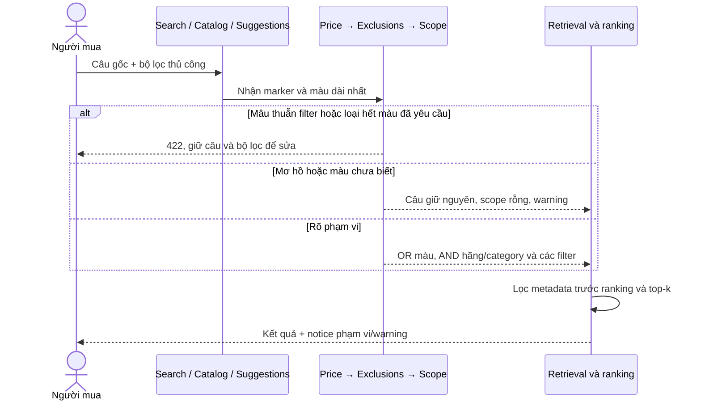

# Tìm theo màu trong mô tả — 15/10/2026

Các câu như `balo màu hồng` trước đây chỉ dùng từ khóa và embedding để xếp hạng. Nay màu được nêu sau `màu`, `color` hoặc `colour` trở thành điều kiện bắt buộc trước ranking/top-k. Cùng áp dụng cho catalog, suggestions, semantic/hybrid, transcript và multimodal có text. Model vẫn encode câu gốc; parser không thay encoder hoặc điểm cosine.

## Hành vi

- `balo màu hồng`: chỉ sản phẩm balo có thành phần hồng trong metadata màu, bao gồm `hồng và đen`.
- `balo màu đỏ đậm`: nhận cụm màu dài nhất đã biết từ catalog; không hạ thành đỏ nếu có đỏ đậm. `màu đỏ` bao gồm đỏ đậm, đỏ phối đen; không so substring với từ khác.
- `balo màu hồng hoặc xám`, `color red or blue`: OR trong cùng trường; giao với hãng/category, giá, size, tồn kho và bộ lọc thủ công.
- `balo màu hồng` + bộ lọc `đen`: 422 `SCOPE_FILTER_CONFLICT`, field `filters.color` hoặc `options.filters.color`. Bộ lọc `hồng và đen` phù hợp với yêu cầu hồng.
- `màu đỏ đậm; không màu đỏ`: 422 `SCOPE_EXCLUSION_CONFLICT`. `màu đỏ; không màu đỏ đậm` vẫn cho phép các sản phẩm đỏ khác. Một nhánh OR bị loại không xóa nhánh còn lại.
- Màu hợp lệ nhưng không có sản phẩm phù hợp trả rỗng. Không đổi sang màu gần giống để có kết quả.
- `màu ultraviolet`, `màu` thiếu tên, `màu đỏ hoặc` thiếu nhánh, `màu đỏ và đen`, `màu đỏ, đen`, OR chéo trường như `màu đỏ hoặc Nike`: không áp scope tự động, giữ câu cho lexical/semantic và hiển thị warning hướng dẫn sửa/chọn bộ lọc. Không đoán AND/OR của một sản phẩm phối màu với hai lựa chọn riêng.

Từ màu đứng riêng không có marker vẫn là lexical/semantic text theo hành vi cũ; không suy mọi từ ngắn như `be`, `cam` thành màu. Không nhận diện màu từ pixel. Màu chỉ chính xác trong phạm vi metadata catalog đã có; các nhóm dữ liệu cần sửa tiếp ở docs17/32 vẫn pending. Không hỗ trợ biểu thức boolean lồng nhau hoặc mọi tên màu thương mại.

## API và vector

Giữ nguyên `interpret_scope` strict boolean, default true. False bỏ cả brand/category/color scope và warning, không bỏ price/exclusions/manual filters. Không thêm option mới. Catalog URL/history và UI checkbox dùng cùng flag; UI đổi nhãn thành “Tự hiểu hãng, loại và màu sản phẩm”, notice ghi “Màu hồng”.

`scope_interpretation` (catalog) và `meta.scope_interpretation` (search) mở rộng enum `clauses[].field` với `color`; `value` là màu canonical, `text` giữ span tên màu NFC gốc. Parser version `brand_category_color_scope_v2`. Ví dụ:

```json
{"enabled":true,"parser_version":"brand_category_color_scope_v2","applied":true,"clauses":[{"text":"balo","field":"category","value":"backpack"},{"text":"hồng","field":"color","value":"hồng"}],"lexical_text":"","warnings":[]}
```

Dùng chung lexicon màu/component/alias và hàm token containment với exclusion parser; không fuzzy màu. Lexical fingerprint tự chứa version scope parser mới. Catalog/model/NPZ/index/cosine/scoring contracts không đổi; không rebuild index chỉ vì parser. Publication vẫn tạo lại lexicon theo catalog mới. Relevant policy và independent relevance/OOD gates vẫn cần bằng chứng riêng.



Mermaid bổ sung mapping của docs30; không thay file Visual Paradigm editable còn pending.

## Kiểm chứng

[COLOR_SCOPE_REPORT](../artifacts/backend/COLOR_SCOPE_REPORT.md) tách test doubles, trình duyệt và model CPU thật. API voice dùng manual transcript trong mốc này, không chứng minh STT. Tài liệu chính thức [Algolia color refinement](https://www.algolia.com/doc/api-reference/widgets/color-refinement-list/react) mô tả lọc theo facet màu; ở đây áp dụng nguyên tắc ràng buộc thuộc tính trước ranking bằng code nội bộ, không thêm dịch vụ Algolia. Đây là nguồn tham khảo thiết kế, không phải evidence hệ thống.
